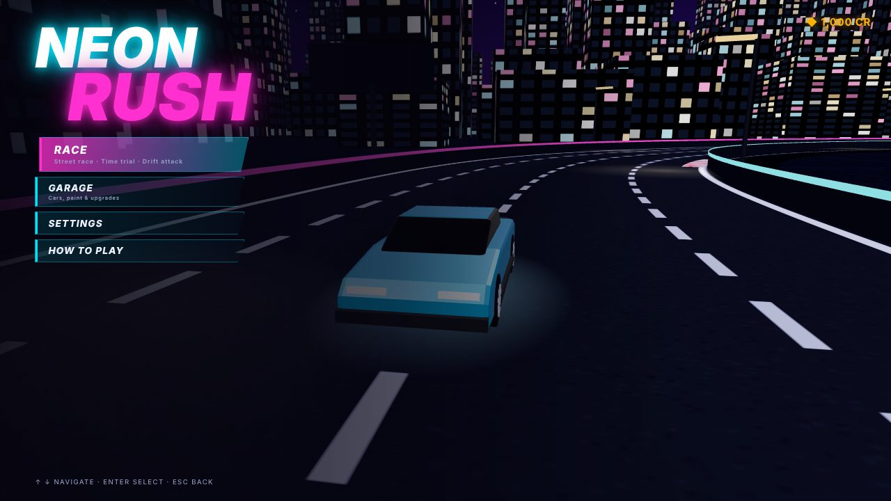
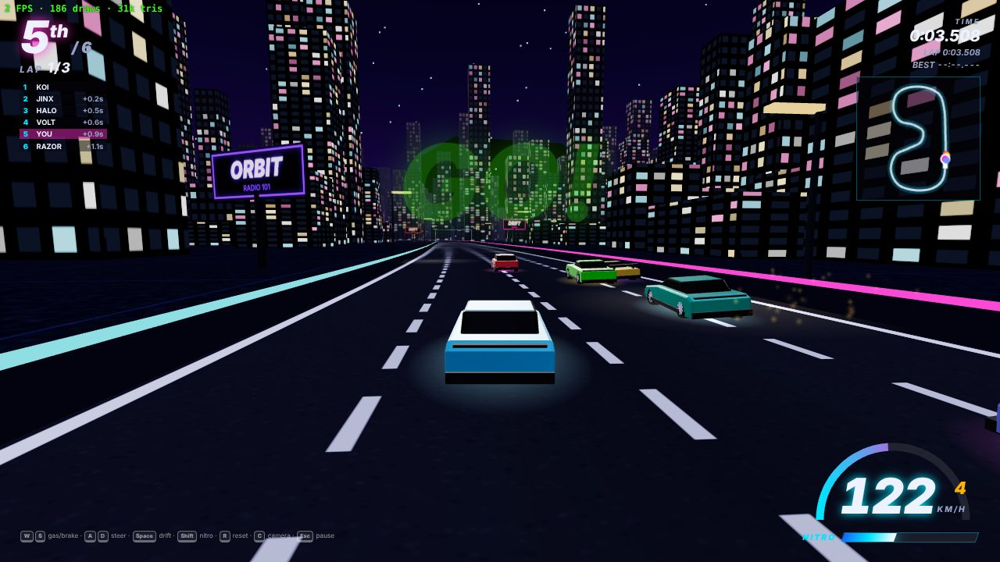
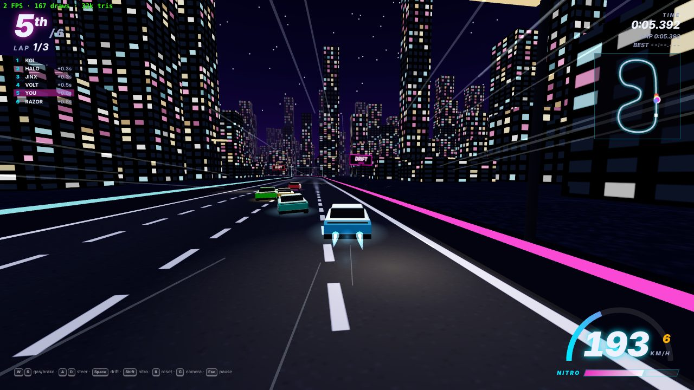
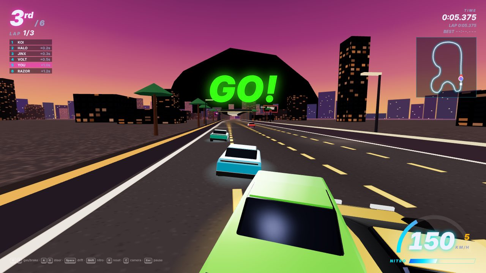
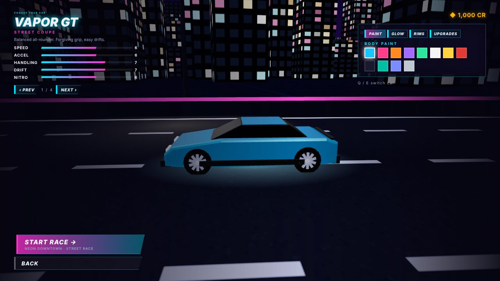
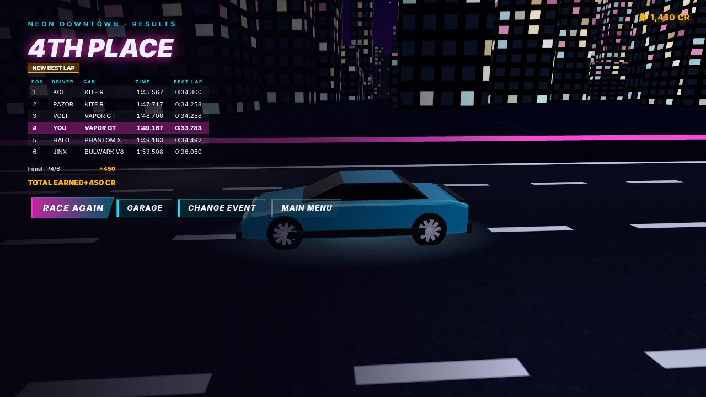

# NEON RUSH — 3D Arcade Street Racing

**Neon Rush** is a stylized 3D arcade street racer for Windows: neon city at night, a dusk harbor highway, nitro, drifting, AI rivals, a garage with paint and upgrades, and an "always one more race" loop.

> العربية أدناه · [Arabic below](#نيون-رش--لعبة-سباق-شوارع-أركيد)

| | |
|---|---|
| Genre | Arcade street racing, third-person chase camera, single player |
| Platform | Windows 10/11 x64 (Electron shell). The same build also runs in any modern browser |
| Engine | [Three.js](https://threejs.org) (WebGL 2) with custom arcade physics. No external game engine |
| Assets | 100 % procedural: models, textures, signs, icon, engine sounds and music are all generated in code. No third-party art or audio, no brands |
| Online | None. No account, no network access, no telemetry |

| | |
|---|---|
|  |  |
|  |  |
|  |  |

*Screenshots come from the automated test run (software renderer, 1280×720).*

## Play it

**Windows build:** download the `NeonRush-win32-x64` artifact from the *Neon Rush (racing game) build* GitHub Actions workflow (or build it yourself, see below). Extract it and run `NeonRush.exe`. See [`docs/PLAYING.txt`](docs/PLAYING.txt) for controls, settings and requirements.

**From source (any OS with Node 18+):**

```bash
cd racing-game
npm install
npm start               # builds and opens the game in Electron
# or: npm run build, then open dist/index.html in Chrome/Edge
```

### Controls

| Action | Keyboard | Gamepad |
|---|---|---|
| Accelerate / brake-reverse | `W` `S` or `↑` `↓` | RT / LT |
| Steer | `A` `D` or `←` `→` | Left stick |
| Handbrake / drift | `Space` | B or RB |
| Nitro | `Shift` or `N` | A or X |
| Reset to track | `R` | Y |
| Camera (chase/far/hood) | `C` | Back |
| Pause | `Esc` or `P` | Start |
| Music on/off, fullscreen | `M`, `F11` | – |

## What's in v1.0

- **Driving:** arcade model with speed-sensitive steering, weight transfer visuals (body roll/pitch), forgiving barriers that slide you along the wall, and no flips or getting stuck. Automatic reset when stuck; `R` resets any time.
- **Drift:** tap the handbrake while turning, keep steering to hold the slide, straighten to recover. Built-in anti-spin assist. Drifts score points and refill nitro; hitting a wall or car breaks the combo.
- **Nitro:** a consumable tank with real acceleration and top-speed boost, plus exhaust flames, FOV kick, speed lines, camera rumble and its own sound. Refills from drifting and a slow trickle.
- **Racing:** countdown, 6-gate checkpoint system (the next gate glows), laps, live positions and gaps, wrong-way warning, finish line, results with estimated times for unfinished rivals.
- **AI rivals:** five rivals that use *the same physics as the player* and only press the same virtual buttons. They precompute a braking-aware speed profile, take inside lines, overtake, avoid traffic, use nitro on straights and recover from crashes. Three difficulty levels. Any catch-up is capped at ±4 %.
- **Modes:** Street Race (3 laps vs 5 rivals), Time Trial (with a saved ghost of your best lap), Drift Attack (2 laps, bronze/silver/gold medals).
- **Content:** 4 cars with genuinely different handling (Vapor GT, Kite R, Bulwark V8, Phantom X); 4 tracks (Neon Downtown, Harbor Highway, and both in reverse) with tunnels, kerbs, neon barriers, street lamps and billboards.
- **Progression:** credits from results, drifting and clean racing; buy cars and wheels; 3 levels each of engine, grip and nitro upgrades; track unlocks; best laps and records. Saved locally.
- **Customisation:** 12 paints, 7 underglow colours (or off), 3 wheel designs. The data model is ready for more parts.
- **Audio:** synthesized engine with a gearbox, tyre squeal, nitro, wind, wall scrape, impacts, UI sounds and a procedural synthwave soundtrack. Separate master, music and effects volumes.
- **UI:** main menu, event setup, garage, settings, how-to-play, pause and results screens. Everything works with keyboard, mouse or gamepad. The HUD shows speed, gear, RPM, nitro, position, standings, lap, timers, minimap, drift combo and messages.
- **Settings:** Low/Medium/High presets, render scale (60–100 %), 720p/900p/1080p window or fullscreen, camera shake, speed effects, FOV, volumes, difficulty, km/h or mph, FPS counter.

## Development

```bash
npm run build        # bundle src/ -> dist/ (esbuild)
npm run dev          # rebuild on change
npm run test:unit    # physics, tracks, AI races on every track, race rules, keyboard-only driving
npm run test:e2e     # drives the real UI in Chromium: menus, every mode, garage, settings, presets
npm run package:win  # release/NeonRush-win32-x64/NeonRush.exe (+ .zip). Works from Linux/macOS too
node scripts/sim-race.mjs downtown   # print a full simulated AI race
node scripts/check-tracks.mjs        # validate track layouts
```

See [`docs/DEVELOPMENT.md`](docs/DEVELOPMENT.md) for the architecture, the reasoning behind the engine choice, how to add cars and tracks, the test report and known limitations.

---

# نيون رَش — لعبة سباق شوارع أركيد

لعبة سباق شوارع ثلاثية الأبعاد بأسلوب Arcade لنظام Windows. تجري أحداثها في مدينة نيون ليلية وعلى طريق ميناء ساحلي وقت الغروب، وتضم النيترو والتفحيط ومنافسين يتحكم بهم الذكاء الاصطناعي، وكراجًا للألوان والتطويرات.

- **التشغيل:** حمّل الحزمة `NeonRush-win32-x64` من GitHub Actions، أو ابنِها بنفسك بالأمر `npm run package:win`، ثم شغّل `NeonRush.exe`. لا تحتاج اللعبة تثبيتًا ولا حسابًا ولا اتصالًا بالإنترنت.
- **التحكم:** `W`/`S` للتسارع والفرامل، `A`/`D` للتوجيه، `Space` للتفحيط، `Shift` للنيترو، `R` لإعادة السيارة إلى المسار، `C` للكاميرا، `Esc` للإيقاف المؤقت.
- **المحتوى:** 4 سيارات تختلف فعلًا في القيادة، و4 مسارات، و3 أنماط لعب (سباق، تحدي الوقت مع شبح أفضل لفة، تحدي التفحيط)، إلى جانب نظام رصيد وتطويرات وفتح مسارات.
- **الأداء:** ثلاثة إعدادات للجودة (منخفضة ومتوسطة وعالية) مع التحكم في دقة العرض.
- **الأصول:** جميع المجسمات والخامات والأصوات والموسيقى مولّدة برمجيًا، ولا توجد فيها أي علامات تجارية أو أصول من طرف ثالث.

التفاصيل الكاملة، وتقرير الاختبارات، والقيود المعروفة موجودة في [`docs/DEVELOPMENT.md`](docs/DEVELOPMENT.md).
